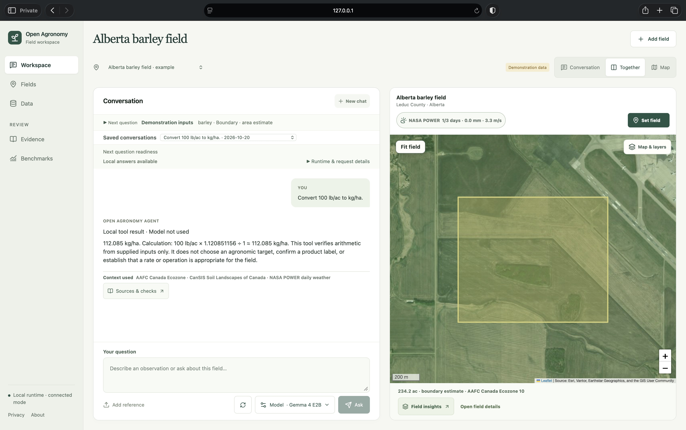

# Open Agronomy Agent

**A local-first GIS workspace for agronomy.** Map a field, ask a question, and inspect the evidence behind the answer. The application brings field maps, local-agent conversations, deterministic calculations, and private field records into one workspace.

**Source-available for non-commercial use, including research and evaluation, under [PolyForm Noncommercial 1.0.0](LICENSE).** Its standard institutional permissions also apply. See [licensing and permitted use](docs/public/licensing.md).



A synthetic demonstration field and a deterministic calculation in the desktop workspace. Geometry is illustrative; mapped context is not a field measurement.

[Workspace guide](docs/public/operations/workspace.md) · [Setup](docs/public/operations/native-setup.md) · [Customize the agent](docs/public/developer/customizing-the-harness.md)

## Explore the workspace

- **Map and explore:** draw or import a boundary, choose satellite or street maps, compare mapped layers, and inspect field geometry and coverage.
- **Ask and inspect:** work with the pinned local model and typed tools, then open sources, assumptions, missing evidence, and the answer trace.
- **Keep field records:** save dated observations and soil tests, review imported tables, and attach private references.
- **Extend the system:** add registered capabilities, admitted sources, or model profiles through the React/FastAPI foundation and governed retrieval pipeline.

## Get started

The exercised source-checkout target is an Apple Silicon Mac with Python 3.11 or 3.12 and Node 24 LTS. Follow [native setup](docs/public/operations/native-setup.md) to install dependencies and explicitly provision the pinned model, then launch:

```bash
PYTHONPATH=src .venv/bin/python scripts/run_cockpit.py \
  --host 127.0.0.1 --port 8000 \
  --frontend --frontend-port 5173 \
  --model-config configs/model.yaml --warm-model
```

Open <http://127.0.0.1:5173>. Stop with **Ctrl+C**. Setup, health checks, storage, and recovery details stay in the [operator guide](docs/public/operations/native-setup.md).

The active document and graph corpus is included. Optional Prairie soil maps use a separately verified [offline spatial pack](docs/public/operations/offline-data-setup.md); unavailable coverage is reported explicitly.

The [Mac app candidate](macos_app/README.md) bundles the workspace and runtime, but is not yet a notarized, downloadable release.

## Build and contribute

Start with the [architecture](docs/public/architecture.md), [customization guide](docs/public/developer/customizing-the-harness.md), and [release-readiness checks](docs/public/developer/release-readiness.md). The supported product path enters through `server/app.py` and `server/services/chat_service.py::execute_agent_request`.

See [contributing](CONTRIBUTING.md), [support](SUPPORT.md), and [security reporting](SECURITY.md). Public screenshots and reports must use synthetic or redacted examples. Keep private records, credentials, and local filesystem paths out of publication.

## Evaluate the current agent

The [evaluation guide](docs/public/operations/release-evaluation.md) identifies
the canonical runner, complete comparison matrix, controller-only references,
and the distinction between software checks and agronomic evidence. Benchmark
results depend on the exact source, model, cohort, arm and runtime. Raw-model,
full-system and hosted Luna results retain their separate execution limits;
neither a refusal nor a fluent answer establishes correctness.

The [current full-evaluation record](docs/reviews/full-evaluation-20261112.md)
tracks the rerun of merged main, refusal and crop-scope checks, and the complete
comparison campaign. Its status explicitly distinguishes planned work from
completed observations. Historical smoke panels and frozen benchmarks remain
evidence for their original revisions.

The calculator checks supplied quantities for nutrient, product, water,
sprayer-calibration, grain-moisture, thermal-time, harvest-index and circular
sampling-area arithmetic. It shows the
units and assumptions and asks for missing or conflicting inputs. A calculated
quantity does not select a field target, authorize a product or establish crop
stage. Seed-mass calculations distinguish overall emergence from survival after
germination and retain the supplied basis. When otherwise complete inputs include
laboratory germination but leave field survival's denominator unclear, the agent
shows both labelled arithmetic scenarios and asks which basis applies. Neither
scenario selects a field rate. Seedling-loss percentages need a clear relation
to germination before their complement can represent overall survival. A reply can supply that basis and, when needed, the laboratory germination
percentage in the same chat without using the model. Conceptual explanations
and requests for field actions retain distinct
evidence requirements.
General product-rate and dose-response explanations, and bounded questions
about evidence to collect, do not require permission to apply a pesticide.
Requested fictional fertilizer examples show the product-to-nutrient arithmetic
without selecting a field target. General concept checks distinguish harvest
drydown from drought tolerance and fertilizer nutrient analysis from pesticide
active ingredients. They are bounded checks, not a general scientific validator.
Impersonal concept comparisons preserve the requested explanation without
requiring an unasked field-management plan. Personal choices, treatment-rate
comparisons and added operational requests retain their evidence requirements.
Explaining why sampling counts use different units does not require a treatment
plan; thresholds retain the sampling method and basis for which they were validated.
Product selection, application rates and use restrictions retain their current
local authority requirements; an unfamiliar product is not an exemption.
Reported disease history informs soil biosecurity across rotations; current
symptoms and diagnostic confirmation retain their own evidence scope.
Root-inspection help explains how to examine intact plants and compare normal
structures before drawing a diagnosis. Healthy-potato scouting describes
conditional signs, field coverage and diagnostic follow-up; local disease
alerts alone do not establish whether a crop is infected.

## Evidence and licensing

This is development and research software. Regional map context is a prior, calculated area is an estimate, and model output is not field truth or pesticide-label authority. Confirm consequential decisions with current local evidence and qualified professional judgment.

Tests and benchmarks establish only their declared scope, not general agronomic competence. Historical experiments and non-active candidates retain their original identities; evaluation cases never enter runtime retrieval or training. Read the [evaluation contract](docs/public/evaluation.md), [governance](docs/public/governance.md), and [retained research record](docs/reviews/residual-polish-checkpoint-20260928.md) for evidence and limitations.

Project-authored software and documentation use [PolyForm Noncommercial 1.0.0](LICENSE), except explicit separate licences and preserved earlier grants. Data, dependencies, and model weights retain their own terms; see [third-party notices](THIRD_PARTY_NOTICES.md) and [licensing](docs/public/licensing.md). Earlier Apache grants remain valid.
