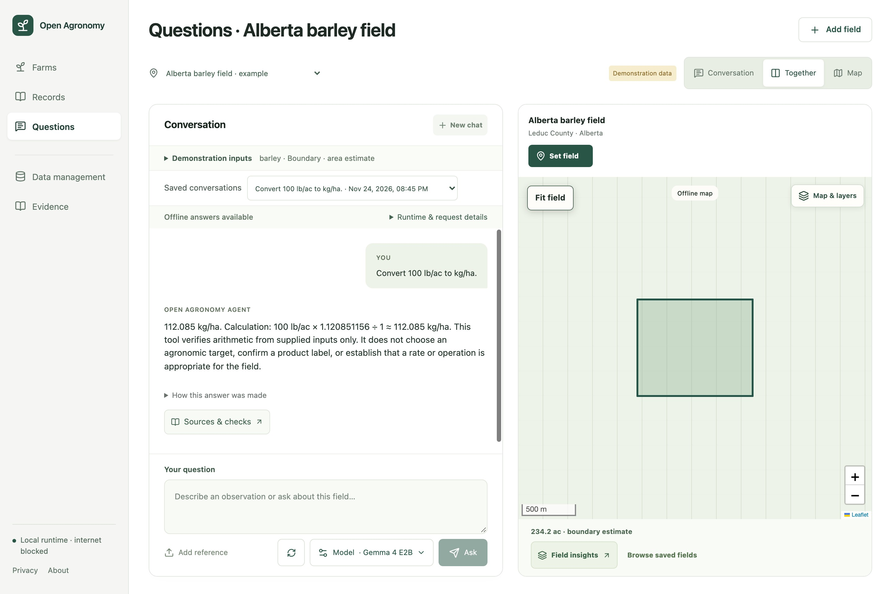

# Open Agronomy Agent

**A local-first GIS workspace for agronomy.** Map a field, ask a question, and inspect the evidence behind the answer. The application brings field maps, local-agent conversations, deterministic calculations, and private field records into one workspace.

**Source-available for non-commercial use, including research and evaluation, under [PolyForm Noncommercial 1.0.0](LICENSE).** Its standard institutional permissions also apply. See [licensing and permitted use](docs/public/licensing.md).



A synthetic demonstration field and a deterministic calculation in the desktop workspace. Geometry is illustrative; mapped context is not a field measurement.

[Workspace guide](docs/public/operations/workspace.md) · [Setup](docs/public/operations/local-browser-setup.md) · [Customize the agent](docs/public/developer/customizing-the-harness.md)

## Explore the workspace

- **Map and explore:** draw or import a boundary, choose satellite or street maps, compare mapped layers, and inspect field geometry and coverage.
- **Ask and inspect:** work with the pinned local model and typed tools, then open sources, assumptions, missing evidence, and the answer trace.
- **Keep field records:** save dated observations and soil tests, review imported tables, and attach private references.
- **Extend the system:** add registered capabilities, admitted sources, or model profiles through the React/FastAPI foundation and governed retrieval pipeline.

## Get started

The exercised source-checkout target is an Apple Silicon Mac with Python 3.11 or 3.12 and Node 24 LTS. Follow [local browser setup](docs/public/operations/local-browser-setup.md) to install dependencies, then launch:

```bash
PYTHONPATH=src .venv/bin/python scripts/run_cockpit.py \
  --host 127.0.0.1 --port 8000 \
  --frontend --frontend-port 5173 \
  --model-config configs/model.yaml
```

Open <http://127.0.0.1:5173> and go to **Questions → Model settings**. Use the download button beside Gemma 4 E2B or E4B, then select it when it is ready. Stop with **Ctrl+C**. See the [operator guide](docs/public/operations/local-browser-setup.md) for setup, health checks, storage, and recovery.

The active document and graph corpus is included. Optional Prairie soil maps use a separately verified [offline spatial pack](docs/public/operations/offline-data-setup.md); unavailable coverage is reported explicitly.

## Build and contribute

Start with the [architecture](docs/public/architecture.md), [customization guide](docs/public/developer/customizing-the-harness.md), and [release-readiness checks](docs/public/developer/release-readiness.md). The supported product path enters through `server/app.py` and `server/services/chat_service.py::execute_agent_request`.

See [contributing](CONTRIBUTING.md), [support](SUPPORT.md), and [security reporting](SECURITY.md). Public screenshots and reports must use synthetic or redacted examples. Keep private records, credentials, and local filesystem paths out of publication.

## Evaluate the current agent

The [evaluation guide](docs/public/operations/release-evaluation.md) explains the
complete comparison of raw models, the full system and hosted Luna. Results bind
the exact source, model, cohort, arm and runtime. The [current campaign record](docs/reviews/full-evaluation-20261112.md)
separates completed observations, diagnostic attempts and pending scientific
review. Historical smoke panels retain their original scope.

The separately frozen development campaign contains 560 original cases and 48 refusal and
crop-scope regressions. It compares raw and full-system answers with two trials
per case on pinned E2B and E4B models and hosted Luna. The cases are exposed
development material; automated labels and different backend runtimes do not
establish field accuracy or a general model ranking.

The latest complete three-model comparison evaluated serving source `ea615e4`
(November 17). Its original 560-case cohort includes 557 real-backend cases and
three synthetic controls. The recorded project-weighted bounds below are on a
0–100 scale; they are **not accuracy percentages or confidence intervals**.

| Model | Raw model | Full system at `ea615e4` |
| --- | ---: | ---: |
| Gemma E2B | 26.44–26.87 | 75.97–76.28 |
| Gemma E4B | 23.90–23.95 | 82.81–82.95 |
| Hosted Luna | 0.00–97.22 | 25.94–95.10 |

Luna lacks provider finish reasons required by the frozen scoring policy, so it
has no comparable primary point score. Different runtimes and output budgets
also limit comparisons. The [complete CSV](docs/public/assets/benchmarks/20261118-canonical-comparison.csv)
retains all twelve reports, both trials, reference sources, controls and unknown
conditions. The [campaign report](docs/reviews/full-evaluation-20261112.md)
explains the separate 48-case regression results and execution paths.

The later `d4def84` collections finished for E2B and Luna, including their recorded
failures. Both E4B attempts lost their Colab assignments with partial full-cohort
results; they cannot be combined into a whole run. Later serving repairs have
source tests and retained-answer replay checks, without a fresh model assessment.
There are no new whole-study scores for those repairs. Superseded generations
were deleted at the owner's request; current results, required baselines, the
latest complete comparison and compact findings remain.

Current workflows include:

- **Calculate from supplied inputs:** field totals, seed rates, nutrient and
  product quantities, water, sprayer calibration, grain moisture and thermal
  time. Recognized calculations with validated complete inputs can run without
  loading a model. Ask “How much seed do I need for 120 ha at 75 kg/ha?”
  to calculate 9,000 kg from the supplied rate.
- **Clarify seed establishment:** when a survival percentage could mean overall
  emergence or survival after germination, inspect both labelled calculations.
  A short reply can select the intended basis and complete the calculation.
  If a daily growing degree-day calculation asks for the base temperature,
  reply in the same chat with the supplied value, such as “Base 10 C.”
- **Keep useful field records:** save observations and soil tests with their
  known sample dates, depths and methods. Corrections preserve the original
  record; an unknown sample date stays unknown. Unconfirmed saves keep the exact
  captured request for retry after reopening, including corrections whose
  original record has already been replaced.
- **Get explanations and scouting help:** ask about measurement methods,
  concept comparisons, study designs, crop symptoms and evidence to collect.
  Supported explanations and record checklists retain their requested scope.
  Current crop, disease
  history and the requested task keep their distinct roles. Model-generated
  explanations still need source and applicability review.

A compound question retains its additional requests: a calculation cannot
silently replace a request for field advice. Product selection and use retain
current crop, target, jurisdiction and authority checks. The report separates
these software contracts and execution checks from judged answer quality.
Readable calculator clarifications preserve the missing input's typed identity;
an omitted budget component, date or measurement remains unknown.

## Evidence and licensing

This is development and research software. Regional map context is a prior, calculated area is an estimate, and model output is not field truth or pesticide-label authority. Confirm consequential decisions with current local evidence and qualified professional judgment.

Tests and benchmarks establish only their declared scope, not general agronomic competence. Historical experiments and non-active candidates retain their original identities; evaluation cases never enter runtime retrieval or training. Read the [evaluation contract](docs/public/evaluation.md), [governance](docs/public/governance.md), and [retained research record](docs/reviews/residual-polish-checkpoint-20260928.md) for evidence and limitations.

Project-authored software and documentation use [PolyForm Noncommercial 1.0.0](LICENSE), except explicit separate licences and preserved earlier grants. Data, dependencies, and model weights retain their own terms; see [third-party notices](THIRD_PARTY_NOTICES.md) and [licensing](docs/public/licensing.md). Earlier Apache grants remain valid.
