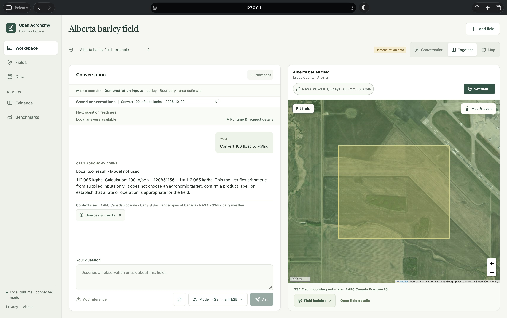

# Open Agronomy Agent

**A local-first GIS workspace for agronomy.** Map a field, ask a question, and inspect the evidence behind the answer. The application brings field maps, local-agent conversations, deterministic calculations, and private field records into one workspace.

**Source-available for non-commercial use, including research and evaluation, under [PolyForm Noncommercial 1.0.0](LICENSE).** Its standard institutional permissions also apply. See [licensing and permitted use](docs/public/licensing.md).



A synthetic demonstration field and a deterministic calculation in the desktop workspace. Geometry is illustrative; mapped context is not a field measurement.

[Workspace guide](docs/public/operations/workspace.md) · [Setup](docs/public/operations/native-setup.md) · [Customize the agent](docs/public/developer/customizing-the-harness.md)

## Explore the workspace

- **Map and explore:** draw or import a boundary, choose satellite or street maps, compare mapped layers, and inspect field geometry and coverage.
- **Ask and inspect:** work with the pinned local model and typed tools, then open sources, assumptions, missing evidence, and the answer trace.
- **Keep field records:** save dated observations and soil tests, review imported tables, and attach private references.
- **Extend the system:** add registered capabilities, admitted sources, or model profiles through the React/FastAPI foundation and governed retrieval pipeline.

## Get started

The exercised source-checkout target is an Apple Silicon Mac with Python 3.11 or 3.12 and Node 24 LTS. Follow [native setup](docs/public/operations/native-setup.md) to install dependencies and explicitly provision the pinned model, then launch:

```bash
PYTHONPATH=src .venv/bin/python scripts/run_cockpit.py \
  --host 127.0.0.1 --port 8000 \
  --frontend --frontend-port 5173 \
  --model-config configs/model.yaml --warm-model
```

Open <http://127.0.0.1:5173>. Stop with **Ctrl+C**. Setup, health checks, storage, and recovery details stay in the [operator guide](docs/public/operations/native-setup.md).

The active document and graph corpus is included. Optional Prairie soil maps use a separately verified [offline spatial pack](docs/public/operations/offline-data-setup.md); unavailable coverage is reported explicitly.

The [Mac app candidate](macos_app/README.md) bundles the workspace and runtime, but is not yet a notarized, downloadable release.

## Build and contribute

Start with the [architecture](docs/public/architecture.md), [customization guide](docs/public/developer/customizing-the-harness.md), and [release-readiness checks](docs/public/developer/release-readiness.md). The supported product path enters through `server/app.py` and `server/services/chat_service.py::execute_agent_request`.

See [contributing](CONTRIBUTING.md), [support](SUPPORT.md), and [security reporting](SECURITY.md). Public screenshots and reports must use synthetic or redacted examples. Keep private records, credentials, and local filesystem paths out of publication.

## Evidence and licensing

This is development and research software. Regional map context is a prior, calculated area is an estimate, and model output is not field truth or pesticide-label authority. Confirm consequential decisions with current local evidence and qualified professional judgment.

Tests and benchmarks establish only their declared scope, not general agronomic competence. Historical experiments and non-active candidates retain their original identities; evaluation cases never enter runtime retrieval or training. Read the [evaluation contract](docs/public/evaluation.md), [governance](docs/public/governance.md), and [retained research record](docs/reviews/residual-polish-checkpoint-20260928.md) for evidence and limitations.

Project-authored software and documentation use [PolyForm Noncommercial 1.0.0](LICENSE), except explicit separate licences and preserved earlier grants. Data, dependencies, and model weights retain their own terms; see [third-party notices](THIRD_PARTY_NOTICES.md) and [licensing](docs/public/licensing.md). Earlier Apache grants remain valid.
